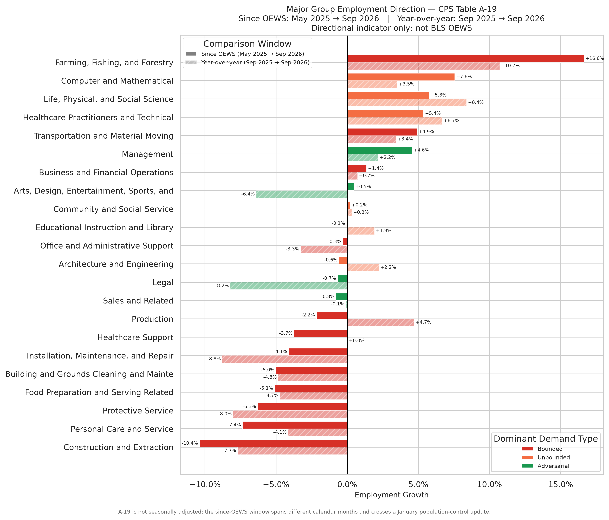

# CPS Employment Direction by Major Group

**File:** `cps_2026_direction.png`

## Data source

BLS Current Population Survey (CPS), Table A-19: *Employed people by occupation, sex, and age* (household data, not seasonally adjusted). The chart uses the **Total (16 years and over)** column.

The A-19 page is a rolling web table that shows only the latest reference month and the same month one year earlier, and BLS replaces it in place each month. The panel behind this chart therefore does not depend on it: `download_cps_history.py` pulls the same 22 series from the BLS API for every month from 2020-01 (October 2025 is absent, since CPS was not collected during the federal shutdown), and the A-19 page is fetched only to cross-check that history. The panel is `seeds/cps_a19_panel.csv`, and the chart's date range is read from it rather than hardcoded — it advances automatically as new months land.

This is **not** BLS Occupational Employment and Wage Statistics (OEWS). Key differences:

| Dimension | BLS OEWS (pipeline primary) | CPS Table A-19 (this chart) |
|-----------|-----------------------------|-----------------------------|
| Frequency | Annual (May reference month) | Monthly |
| Sample size | ~1.1M employer records | ~60k household interviews |
| Occupation detail | ~830 SOC 6-digit codes | 22 SOC major groups |
| Latest available | May 2025 | September 2026 |
| Seasonally adjusted | n/a (annual) | No |
| Wage data | Yes | No |

## What this chart shows

Each SOC major group gets a pair of bars, colored by its dominant demand type (from `exposure_volume_by_group.csv`):

- **Since OEWS** (solid) — from the last panel month at or before the OEWS reference month through the latest CPS month. Currently **May 2025 → Sep 2026**. This is the window the chart exists to show: the stretch of time OEWS does not yet cover.
- **Year-over-year** (hatched) — the latest month against the same month a year earlier. Currently **Sep 2025 → Sep 2026**.

The anchor is deliberately pinned to the OEWS handoff rather than to the earliest month in the panel, so back-filling older CPS history does not change what the solid bars mean. It is May 2025 itself, the OEWS reference month, now that the panel carries that month.

## How to interpret it

Read this as a directional signal — which broad groups are expanding vs. contracting — not as a precise measurement. CPS monthly figures carry sampling error, and changes smaller than ~2% are within the margin of noise for many groups.

**Demand type coloring** reflects whether the group's modeled AI exposure is driven mainly by Bounded (structural displacement), Unbounded (productivity absorption), or Adversarial (arms-race) tasks. If the model is correct, Bounded groups should tend toward contraction and Unbounded/Adversarial groups toward expansion.

**Compare the two bars before drawing conclusions.** Where they disagree, the disagreement is usually the story. Measured 2026-10-02 from `cps_a19_panel.csv` (growth = employed in 2026-09 over employed in 2025-05, and over 2025-09, minus one; n = 22 groups), the two bars have the same sign for 17 of 22 groups and opposite signs for 5: Architecture and Engineering (−0.6% vs +2.2%), Education, Training, and Library (−0.1% vs +1.9%), Arts, Design, Entertainment, Sports, and Media (+0.5% vs −6.4%), Healthcare Support (−3.7% vs +0.0%, where the year-over-year value is +0.018%) and Production (−2.2% vs +4.7%). The largest gaps in size are Legal (−0.7% vs −8.2%, 7.5 pp), Production (6.9 pp), Arts and Media (6.9 pp) and Farming, Fishing, and Forestry (+16.6% vs +10.7%, 5.9 pp; the since-OEWS window runs May→Sep and so spans different calendar months, which may carry part of the agricultural gap). Where the two bars agree in sign and rough magnitude — Construction and Extraction (−10.4% vs −7.7%), Food Preparation and Serving (−5.1% vs −4.7%), Building and Grounds (−5.0% vs −4.8%), Community and Social Service (+0.2% vs +0.3%) — the reading is more robust.

## Honest limitations

- **The since-OEWS window is not seasonally adjusted and spans different calendar months.** May→Sep can pick up seasonal hiring patterns that have nothing to do with AI. The year-over-year window is clean on this point, which is exactly why both are shown.
- **The since-OEWS window crosses a January.** CPS introduces updated population controls with each January release and does not revise prior months, so part of any level change across that boundary is a definitional artifact rather than labor-market movement. A-19's own footnote flags this.
- The CPS captures employed persons, not job postings. A group can grow in employment while productivity-per-worker rises — consistent with either displacement (fewer workers, same output) or expansion (more output, same workers). Direction alone doesn't distinguish.
- CPS occupational coding is coarser than OEWS. "Computer and Mathematical Occupations" includes both software engineers (likely Unbounded, growing) and statistical assistants (likely Bounded, declining). The group average masks divergence within it.
- About sixteen months of CPS data (May 2025 → Sep 2026) cannot confirm or refute the model's long-run predictions. It is an early-window directional check only.
- CPS occupation coding changed with the 2018 SOC / 2020 Census update, so these categories are not comparable to pre-2020 CPS data. The panel is back-filled only to 2020-01 for that reason — see [cps_data_expansion.md](../cps_data_expansion.md).
