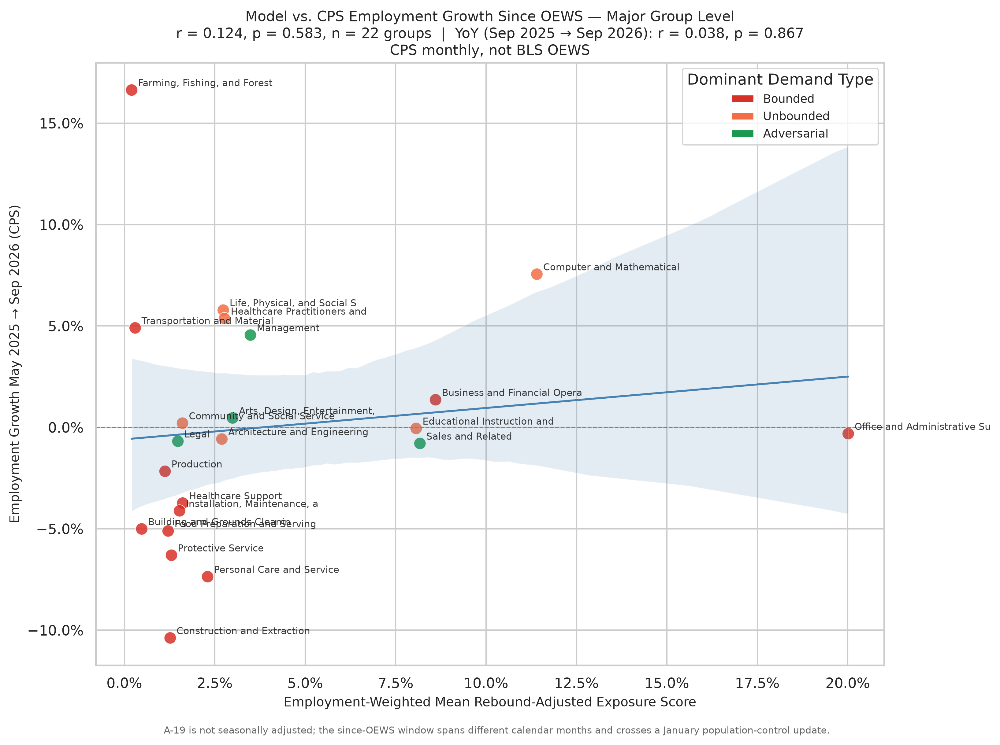
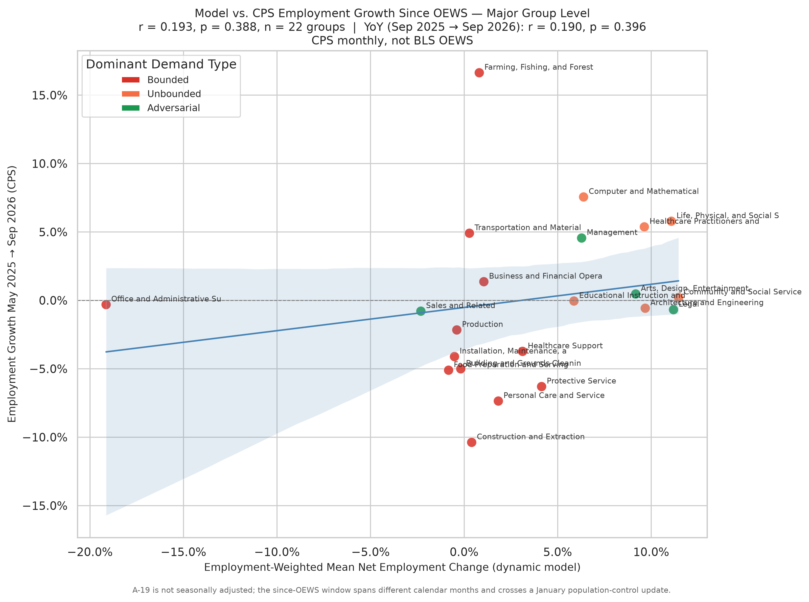

# Model vs. CPS Employment Growth — Major Group Level

Two charts, same layout, different model scores:

- **`cps_rebound_model_vs_actual.png`** — x-axis: employment-weighted mean `occupation_exposure` (rebound-adjusted, gross ≥ 0; correct sign is **negative**)
- **`cps_dynamic_model_vs_actual.png`** — x-axis: employment-weighted mean `net_employment_change` (dynamic model, signed; correct sign is **positive**)





## What these charts show

Each dot is one SOC major occupation group (n = 22). The x-axis is the model's aggregated prediction for that group. The y-axis is actual employment growth from BLS CPS Table A-19 (monthly household survey, not BLS OEWS) over the **since-OEWS** window — currently May 2025 → Sep 2026, the stretch OEWS does not yet cover.

The **year-over-year** window (currently Sep 2025 → Sep 2026) is reported in each chart's subtitle rather than plotted separately. It is the seasonally cleaner comparison, so a large gap between the two is a warning that the plotted correlation is picking up seasonality. Both windows are drawn as bars in [cps_2026_direction.md](cps_2026_direction.md).

## How group scores are computed

For each major group:

```
group_score = Σ(model_score × BLS_employment) / Σ(BLS_employment)
```

Employment weights come from the most recent OEWS annual data (the latest `TOT_EMP_*` column, currently `TOT_EMP_2025`).

## Current results

Data: CPS A-19 monthly panel through September 2026; model scores from the current pipeline run.

| Model | Window | r | p | n | Correct sign? |
|-------|--------|--:|--:|--:|:-------------:|
| Rebound-adjusted | Since OEWS (May 2025 → Sep 2026) | +0.124 | 0.583 | 22 | No |
| Rebound-adjusted | Year-over-year (Sep 2025 → Sep 2026) | +0.038 | 0.867 | 22 | No |
| Dynamic net change | Since OEWS (May 2025 → Sep 2026) | +0.193 | 0.388 | 22 | Yes (positive, expected positive) |
| Dynamic net change | Year-over-year (Sep 2025 → Sep 2026) | +0.190 | 0.396 | 22 | Yes (positive, expected positive) |

Measured 2026-10-02 from the validate stage's console output (`CPS cps_rebound_model_vs_actual.png`, `CPS cps_dynamic_model_vs_actual.png`; n = 22 major groups; `p` is two-sided Pearson). The two windows share one end month (Sep 2026) and a year of employment change, so the two rows per model are not independent measurements.

**No result is conventionally significant** (0 of 4; smallest p = 0.388, against a threshold of |r| ≈ 0.42 at n = 22). The dynamic model's r is +0.193 since OEWS and +0.190 year-over-year, both the correct sign and both far from significance. These data do not distinguish a weak positive relationship from none.

This is a material change from the previous model version. Before Adversarial share was counted as absorption capacity (it was scored as pure displacement, contradicting the framework's definition of Adversarial as a carve-out from Unbounded — see `framework.md` § Redistribution rule), this row read r = +0.482 (p = 0.023) and was cited as a cross-survey replication of the OEWS sector result. The change improved the OEWS fit at the time (composite r +0.528 → +0.542; measured on major-group totals the composite now reads +0.509) and removed the CPS one. The sectors that move most under the change — Legal, Sales and Related, Protective Service, Management — are the Adversarial-heavy ones, and their 2025→2026 CPS growth does not line up with their improved scores the way their 2022→2025 OEWS growth does. Which survey is closer to the truth for those sectors is not determinable from the data on hand; the CPS reading is one endpoint of a household survey at n = 22, and the earlier significant value moved by 0.1 on a two-month shift in endpoints, so neither the old result nor its loss should carry much weight. Treat the cross-survey replication as an open question rather than a settled one.

**The rebound-adjusted model has no support here, and its sign is wrong on both windows.** Its correct sign is negative; both windows return small positive correlations. Neither is anywhere near significant (p = 0.58 and p = 0.87), so this is best read as no signal rather than as evidence against.

## Why the results are weak

**n = 22 has very low statistical power.** A true effect of |r| ≈ 0.2 is undetectable with 22 groups at conventional thresholds (need |r| ≳ 0.43 for p < 0.05). Adding CPS months does not help: n is the number of major groups, not the number of observations.

**Group-level aggregation dilutes the signal.** Bounded and Unbounded occupations with opposing trajectories pool within the same major group. "Computer and Mathematical" contains both fast-growing Unbounded roles and shrinking Bounded ones; the aggregate averages them out.

**CPS monthly data has high sampling variance.** Smaller groups (Farming, Legal, Life Science) carry margins of error that can exceed the measured change itself.

**Neither window is seasonally adjusted, and both cross the January 2026 population-control update.** Only the since-OEWS window also spans different calendar months (May→Sep). Farming, Fishing, and Forestry reads +16.6% over that window against +10.7% year-over-year (both measured 2026-10-02 from `cps_a19_panel.csv`), a 5.9 pp gap that part-seasonal agricultural hiring may explain; this is not tested here. This is one reason to weight the year-over-year row over the since-OEWS one. The similar dynamic-model r values (+0.193 and +0.190) are partly mechanical, since the year-over-year window is nested inside the since-OEWS window; they are not two independent confirmations.

**The window is short.** Major-group employment is driven by sector-specific confounders (interest rates, post-pandemic normalization, policy changes) that dominate a roughly one-year AI signal.

## Comparison with occupation-level and OEWS sector-level results

The occupation-level rebound-adjusted validation (n ≈ 397, 2024→2025 OEWS) finds r = −0.219 (p < 0.001) — significant because of the larger sample. The dynamic model's sector-level OEWS validation finds r = +0.509 (p = 0.015) at n = 22 sectors — stronger because it uses four years of OEWS data per sector, not a single short CPS window.

These charts are best read as a descriptive extension of the time series — showing the broad direction by group since OEWS ends — rather than as a validation. The OEWS-based charts ([dynamic_sector_level_employment_validation.md](dynamic_sector_level_employment_validation.md), [sector_level_employment_validation.md](sector_level_employment_validation.md)) remain the more reliable test.
