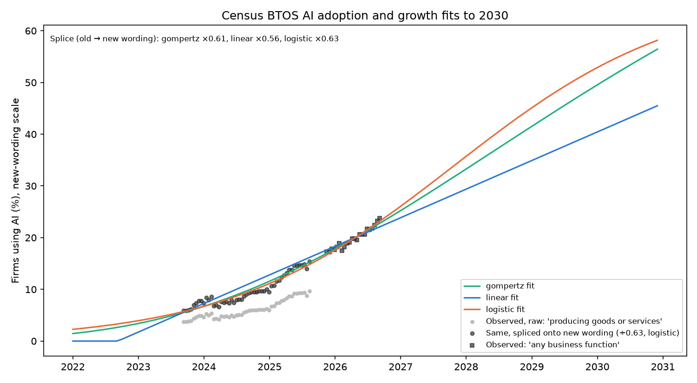

# Composition Projection: BTOS AI Adoption

**File:** `forecast_btos_adoption.png`

## What this chart shows

This is the Census Business Trends and Outlook Survey (BTOS) share of firms that used AI in the last two weeks: the forecast's adoption driver `A_t`. BTOS changed the question at the end of 2025:

- **"…in producing goods or services"** — 51 biweekly points, 2023-09-10 to 2025-08-10, 3.7% to 9.7%. Shown raw (light grey) and divided by the logistic fit's splice multiplier (dark), which places them on the new wording's scale.
- **"…in any of its business functions"** — 22 points, 2025-11-16 to 2026-09-06, 17.2% to 23.8% (squares).

Each curve is fitted to both wordings at once, with a fitted multiplicative splice parameter mapping the old wording onto the new one. **No period carries both wordings.** The old series ends 2025-08-10 and the new one begins 2025-11-16, so the splice is identified only by each growth form's continuity across that 14-week gap. The multiplier's spread across forms (0.560 to 0.631) shows how much it depends on the form. The 2023–2025 adoption values that identify β_AI come from these rescaled old-wording points.

## Reading

Measured 2026-10-02 from `btos_adoption_fits.csv`.

| Fit | Splice multiplier (old → new) | Adoption 2025-12 | Adoption 2030-12 | Status |
|---|---:|---:|---:|---|
| Linear | 0.560 | 17.9% | 45.5% | accepted |
| Logistic | 0.631 | 17.0% | 58.1% | accepted |
| Gompertz | 0.613 | 17.3% | 56.4% | accepted; its ceiling sits at the upper bound of 100% |
| Exponential | 0.630 | — | 159% | rejected: exceeds 100% by 2030-12 |

The three accepted fits agree closely through 2026 (within 2 points) and diverge from 2027.

Stage 2 of the forecast uses the logistic fit's annual means as `A_t`. The linear and Gompertz backfills are run as sensitivity checks and move β_AI by at most 0.07 on either instrument (see `docs/framework.md` § Composition Forecast).

## Limitations

- The estimation periods reach an annual adoption of 0.14 at most (2025). By 2030 every accepted fit is three to four times higher. The forecast's AI term is therefore an extrapolation far outside the adoption range it was estimated on.
- BTOS measures whether a firm uses AI at all, not how intensively. It is a proxy for exposure growth, not a measure of task penetration.
