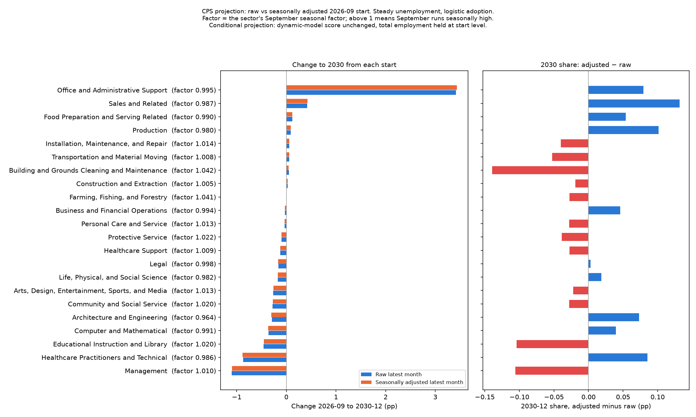

# Composition Projection: Raw vs Seasonally Adjusted CPS Start

**File:** `forecast_cps_start_basis.png`

## What this chart shows

**It tests whether starting the CPS projection in September, a month with its own seasonal pattern, changes the answer. The chart has two panels.** Table A-19 is not seasonally adjusted, so the latest month's sector shares carry that month's seasonality into the projection.

**Left panel, "Change to 2030 from each start".** Each sector has two bars: its projected change in employment share, in percentage points, from 2026-09 to 2030-12, under the reference scenario (steady unemployment, logistic AI adoption). The blue bar starts from the raw 2026-09 shares. The orange bar starts from the same shares divided by each sector's September seasonal factor and renormalised to sum to one. Sectors are ordered by the raw projection.

**Reading the factor in each label.** The factor is that sector's September seasonal factor (`cps_seasonal_factors.csv`). Above 1 means September runs seasonally high for the sector, so the adjusted start is lower than the raw one. Factors come from a centred 2×12 moving average; the ratios are taken from 2022 onward (the moving average behind them reaches back into 2021). October 2025 was never collected, so April–December factors rest on 3 years and January–March on 4.

**The raw start stays primary.** The other six forecast charts, and the CPS panel of `forecast_sector_change_2030.png`, use the raw start. This chart is the only place the adjusted start appears.

**Right panel, "2030 share: adjusted − raw".** One bar per sector, in the left panel's order: the adjusted start's projected 2030-12 share minus the raw start's, in percentage points (blue positive, red negative). The left panel compares changes, which hide the seasonal effect because it sits in the start level and cancels out of a change. The right panel compares the levels where it shows.

## Reading

Measured 2026-10-02 from `forecast_sector_paths.csv` (filter `instrument == "cps"`, `unemployment_scenario == "steady"`, `adoption_fit == "logistic"`, n = 22 sectors). Change = (share at `as_of == "2030-12"` − share at `as_of == "2026-09"`) × 100, per `start_basis`.

- **The two starts give nearly the same projection.** The absolute raw-versus-adjusted gap in projected change has median 0.002 pp and mean 0.004 pp across the 22 sectors.
- **The largest gaps are:**

| Sector | Raw change | Adjusted change | Gap |
|---|---|---|---|
| Office and Administrative Support | +3.414 | +3.432 | +0.018 |
| Healthcare Practitioners and Technical | −0.870 | −0.885 | −0.015 |
| Architecture and Engineering | −0.292 | −0.303 | −0.012 |

- **Sector order here is the raw projection's, as on the chart.**
- **No sector changes sign** (0 of 22 have raw and adjusted changes of opposite sign).
- **The start shares themselves move more than the projections do.** The largest adjustment to a sector's 2026-09 share is 0.136 pp (Building and Grounds Cleaning and Maintenance, factor 1.042, whose share falls).

**The 2030 share gap is larger than the change gap, and it carries the start-share adjustment through almost unchanged.** Same filter, adjusted minus raw share at `as_of == "2030-12"`, times 100, n = 22 sectors: median absolute gap 0.043 pp, mean 0.057 pp, maximum 0.139 pp. The start column is the same difference at `as_of == "2026-09"`.

| Sector | 2026-09 start-share gap (pp) | 2030-12 share gap (pp) |
|---|---|---|
| Building and Grounds Cleaning and Maintenance | −0.136 | −0.139 |
| Sales and Related | +0.128 | +0.132 |
| Management | −0.112 | −0.106 |
| Educational Instruction and Library | −0.111 | −0.104 |
| Production | +0.101 | +0.101 |

All 22 sectors have the same sign at start and at 2030 (22 of 22), the correlation between the two columns across sectors is 0.996, and the largest start-to-2030 movement in any sector's gap is 0.018 pp (Office and Administrative Support). The gap is positive for 10 sectors and negative for 12. So the seasonal effect is a level offset of up to about 0.14 pp that the projection does not remove or amplify. It is small beside the projected changes for the large movers (Office and Administrative Support +3.4 pp) but comparable to those of the small ones.

## Limitations

- Each factor rests on 3 or 4 years per calendar month, so a single unusual year moves it. Farming, Fishing, and Forestry has the widest factor range, 0.300 (0.882 in April to 1.182 in July; `cps_seasonal_factors.csv`, max minus min `factor` per `soc_major`; next are Educational Instruction and Library 0.152 and Building and Grounds 0.134).
- The adjustment changes the start shares only; the score and the fitted slopes are not re-estimated, because `forecast_slope_decomposition.csv` is written before either start is built and has no `start_basis` column.
