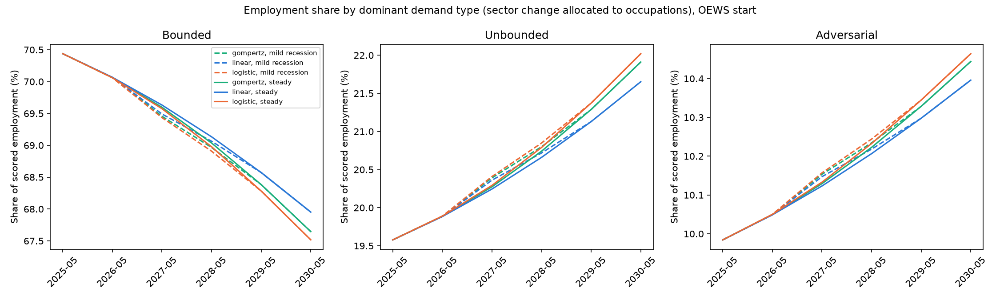

# Composition Projection: Employment by Dominant Demand Type

**File:** `forecast_demand_type_shares.png`

## What this chart shows

**This chart shows the OEWS projection only.** CPS estimates the AI-era slope with the opposite sign and would reverse the sector moves that drive these lines. Both apply the AI term at about four times the highest adoption it was estimated on.

This is the share of scored OEWS employment in occupations whose dominant demand type is Bounded, Unbounded or Adversarial, from May 2025 to May 2030. Line color is the adoption fit; solid lines are steady unemployment and dashed lines are the mild recession.

**This is an allocation, not an occupation-level projection.** Each occupation is given its sector's projected growth rate. A demand-type share therefore moves only because occupations of that type are concentrated in sectors projected to gain or lose. The chart shows no movement of workers between occupations. Part of the movement is built in: the sector score is computed from the same demand-type composition, so any positive slope moves share from Bounded-heavy toward Unbounded-heavy sectors. Each occupation's `dominant_demand` label comes from the model report and is not re-derived.

## Reading

Measured 2026-10-02 by applying `allocate_to_occupations` and `demand_type_shares` to `forecast_sector_paths.csv` (OEWS, 770 occupations).

| Demand type | May 2025 | May 2030, logistic | May 2030, linear |
|---|---:|---:|---:|
| Bounded | 70.44% | 67.52% | 67.95% |
| Unbounded | 19.58% | 22.02% | 21.65% |
| Adversarial | 9.98% | 10.46% | 10.40% |

These are steady-unemployment values. The mild recession gives the same 2030 values to within 0.01 points.

Under the OEWS projection, the share of scored employment in Bounded-dominant occupations is 2.5 to 2.9 points lower by 2030 across the three adoption fits. That happens because Bounded-dominant occupations sit mostly in sectors the OEWS projection shrinks. The CPS projection would reverse it.

## Limitations

- Allocation hides within-sector differences by construction.
- These shares cover the 770 scored occupations, not total employment.
