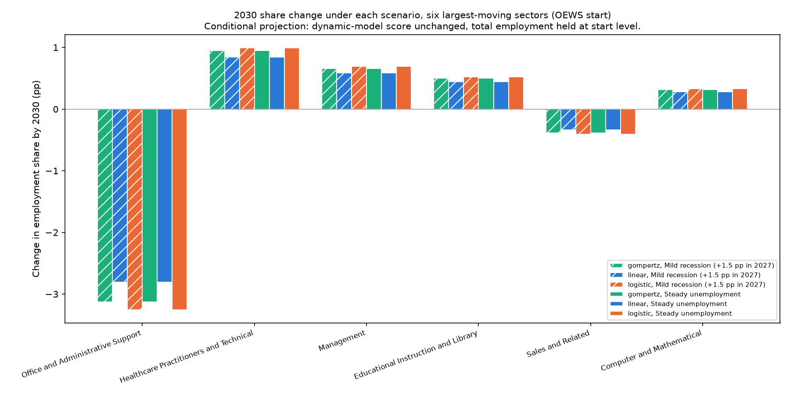

# Composition Projection: Scenario Comparison

**File:** `forecast_scenario_comparison.png`

## What this chart shows

**This chart shows the OEWS projection only.** CPS estimates the AI-era slope with the opposite sign and projects the reverse for these sectors. Both apply the AI term at about four times the highest adoption it was estimated on.

The chart shows the projected 2030 change in employment share for the six sectors that move most under the OEWS reference scenario. Each bar is one combination of unemployment scenario (hatched = mild recession, solid = steady) and adoption fit (color). The start is May 2025, and it is a conditional projection with total employment held at its start level.

## Reading

Measured 2026-10-02 from `forecast_sector_paths.csv`, filter `instrument == "oews"`.

**The six scenario combinations change the size of each sector's move but not its sign.**
- Office and Administrative Support's 2030 change spans −2.81 to −3.26 points.
- Healthcare Practitioners and Technical's spans +0.84 to +0.99.

The adoption fit matters more than the unemployment scenario, for the reason given in `forecast_sector_paths.md`: the recession's unemployment changes net to zero by 2030.

**The instruments disagree in sign.** CPS projects Office and Administrative Support gaining share under all six combinations. Its magnitudes use a different start date, horizon and employment base, so they are not directly comparable to OEWS's. Which instrument's AI-era slope is right matters more than which scenario is chosen.

## Limitations

- OEWS only; see `forecast_sector_change_2030.md` for CPS.
- The scenarios are stated assumptions, not forecasts.
