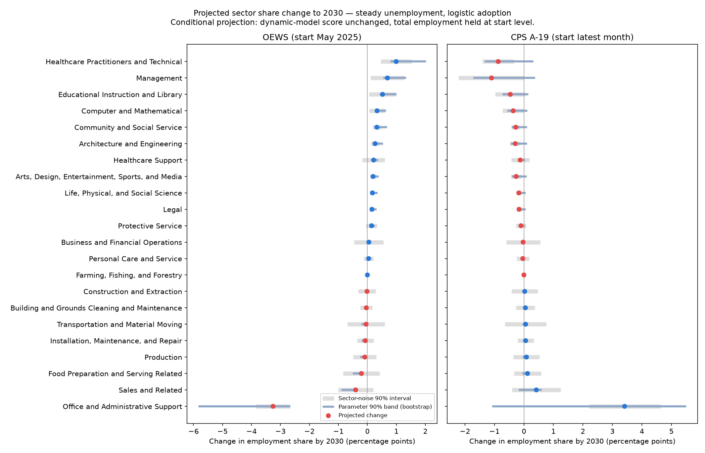

# Composition Projection: Sector Share Change by 2030

**File:** `forecast_sector_change_2030.png`

## What this chart shows

**The two panels project opposite moves.** OEWS and CPS estimate the AI-era change in the score's slope with opposite signs, so they project the same sectors moving in opposite directions. Both apply that AI term at about four times the highest adoption it was estimated on.

This is each sector's projected change in employment share, in percentage points, from the start date to 2030. It uses the reference scenario: steady unemployment and logistic AI adoption. Sectors are ordered by the OEWS projection, and the two panels share that order.

- **OEWS:** May 2025 → May 2030, from OEWS sector totals.
- **CPS:** September 2026 → December 2030, from the CPS A-19 monthly panel, projected from the raw (not seasonally adjusted) September 2026 shares. A-19 is a different CPS product from the 22-sector rollup the CPS slope is estimated on. Their 2025 sector shares (the panel's eleven 2025 months against the rollup's 2025 annual average) differ by 0.10 pp on average and at most 0.37 pp (measured 2026-10-02, n = 22 sectors). The seasonally adjusted start is charted in `forecast_cps_start_basis.md`.

Each sector shows:
- **Dot:** the projected change, blue for a gain and red for a loss.
- **Blue band:** the 5th–95th percentile across 2,000 bootstrap resamples of the historical periods. The 95 (OEWS) and 91 (CPS) replicates that could not identify the AI term were skipped, which narrows the band.
- **Grey band:** sector noise, the typical yearly scatter of a sector around the fitted slope, accumulated over the horizon.

It is a conditional projection, not a forecast of employment levels. Total employment is held at its start level, so only shares move.

## Reading

Measured 2026-10-02 from `forecast_sector_paths.csv` (filter `unemployment_scenario == "steady"` and `adoption_fit == "logistic"`, n = 22 sectors) and `forecast_sector_stability.csv`.

| Sector | OEWS change (band; LOO) | CPS change (band; LOO) |
|---|---|---|
| Office and Administrative Support | −3.26 (−5.83, −2.66; −4.45 to −2.93) | +3.41 (−1.08, +5.50; +0.70 to +4.28) |
| Healthcare Practitioners and Technical | +0.99 (+0.79, +2.02; +0.88 to +1.43) | −0.87 (−1.32, +0.32; −1.07 to −0.19) |
| Management | +0.69 (+0.56, +1.34; +0.62 to +0.98) | −1.10 (−1.71, +0.38; −1.36 to −0.24) |
| Sales and Related | −0.40 (−0.89, −0.32; −0.61 to −0.36) | +0.42 (−0.17, +0.61; +0.10 to +0.50) |

LOO is the range across leave-one-period-out refits. CPS rows use the raw start (`start_basis == "raw"`). From the seasonally adjusted start the same four sectors read +3.43, −0.88, −1.09 and +0.42; across all 22 sectors the largest raw-versus-adjusted gap in projected change is 0.018 pp. That small gap follows from the shared slope path, since only the start shares differ; it bounds the seasonal effect on the start level and is not a robustness test.

**Only the signs are comparable across the panels, not the magnitudes.** The horizons differ (60 against 51 months), the employment bases differ, and CPS reaches SOC sectors through a crosswalk.

**The bands show one result repeated, not 22 independent ones.** Every sector's projection is the same slope path multiplied by that sector's fixed score. The OEWS band excludes zero for 21 of 22 sectors; the exception, Farming, Fishing, and Forestry, has a score at the employment-weighted mean. The CPS band excludes zero for 0 of 22. OEWS's narrower bands reflect its smaller β_AI standard error (0.18 against 0.50). They do not show that OEWS is the right instrument, and neither band covers the disagreement between instruments.

**Leave-one-period-out refits keep every tabled sector's sign, but CPS sizes depend on single periods.** Office and Administrative Support's CPS projection ranges from +0.70 to +4.28 pp when one period is dropped. Across all 22 sectors the refits keep the point estimate's sign for 22 of 22 on OEWS and 20 of 22 on CPS; the two exceptions (Business and Financial Operations, Farming, Fishing, and Forestry) project changes within 0.03 pp of zero. Like the bands, this is one slope path repeated across 22 sectors, and it measures stability, not accuracy. No leave-one-period-out range was computed for β_AI itself, which rests on three periods.

## Limitations

- The AI term rests on three periods per instrument and is extrapolated well beyond its adoption range (see `forecast_btos_adoption.md`). The projected 2030 slopes lie outside the historical range on both instruments.
- The bands exclude model-specification uncertainty.
- The CPS slope history crosses the 1991→92, 1993→94, 2002→03 and 2010→11 classification seams, kept in Stage 2 without a sensitivity row. The OEWS history excludes the 2009→10 and 2018→19 SOC level breaks (see `framework.md` § Composition Forecast, Method).
