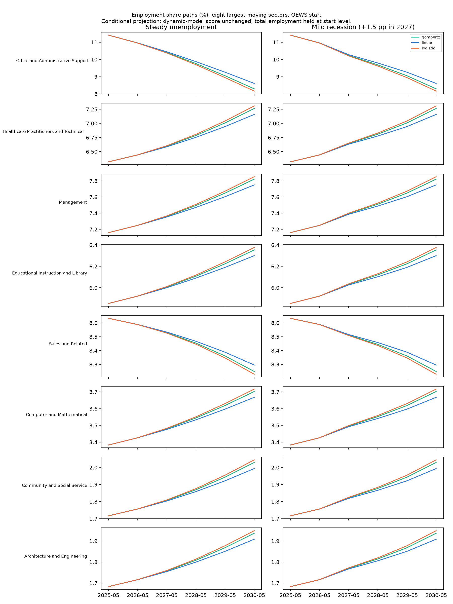

# Composition Projection: Sector Share Paths

**File:** `forecast_sector_paths.png`

## What this chart shows

**This chart shows the OEWS projection only.** CPS estimates the AI-era slope with the opposite sign and projects the reverse for these sectors. Both apply the AI term at about four times the highest adoption it was estimated on.

These are employment-share paths from May 2025 to May 2030 for the eight sectors whose OEWS projection moves most under the reference scenario. There is one row per sector and one column per unemployment scenario. Each line is one adoption fit: linear, logistic or Gompertz.

The **mild recession** scenario raises unemployment by 1.5 points in 2027, then lowers it by 0.75 points in each of 2028 and 2029. The **steady** scenario holds it flat. It is a conditional projection with total employment held at its start level.

## Reading

Measured 2026-10-02 from `forecast_sector_paths.csv`, filter `instrument == "oews"`.

- **The adoption fits change the size of each move, not its direction.** For Office and Administrative Support, the 2030 change is −2.81 points (linear), −3.12 (Gompertz) and −3.26 (logistic). Linear is smallest because it reaches the lowest adoption by December 2030 (45.5%, against 58.1% for logistic).
- **The recession scenario barely moves the 2030 end-point.** Office and Administrative Support is at −3.25 under recession against −3.26 under steady (logistic). That's because the scenario's unemployment changes sum to zero over 2027–2029. Its effect shows only in the 2027–2028 shape of the paths.

## Limitations

- The scenarios are stated assumptions, not forecasts of unemployment or adoption.
- See `forecast_sector_change_2030.md` for CPS and for uncertainty bands.
