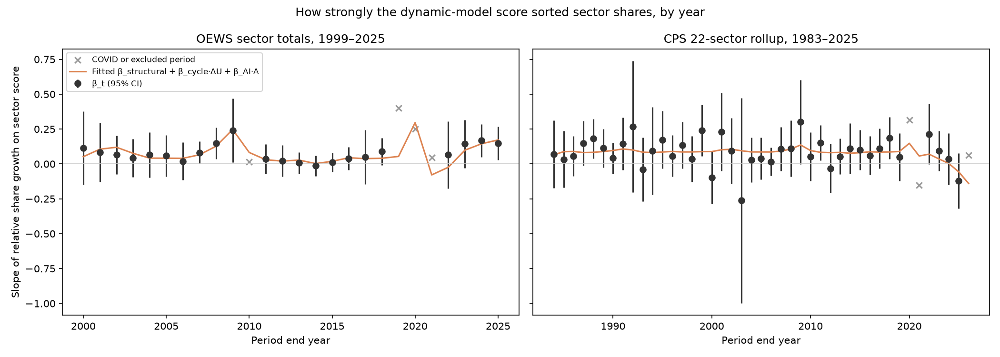

# Composition Projection: Slope History

**File:** `forecast_slope_history.png`

## What this chart shows

Each point is one year's **slope**: across the 22 SOC major sectors, how much a sector's employment share grew, relative to total employment, per unit of its dynamic-model score (`net_employment_change`, employment-weighted to sector). Error bars are 95% confidence intervals. A positive slope means sectors the model scores as absorbing labor gained share that year.

Grey crosses mark periods left out of the decomposition: COVID (2019→20, 2020→21), the two OEWS SOC-revision level breaks (2009→10, 2018→19), and CPS 2025→26, whose 2026 figure averages only January–August. The CPS classification seams (1991→92, 1993→94, 2002→03, 2010→11) are **not** excluded. The orange line is the Stage 2 fit, `β_structural + β_cycle·ΔU + β_AI·A`, evaluated at each year's unemployment change and AI adoption. A is zero before 2023, so the AI term only shapes the last three fitted points.

The left panel is estimated from OEWS sector totals (1999–2025). The right panel uses the CPS 22-sector rollup (1983–2025). That is the CPS instrument's *estimation* history; its projection starts from CPS Table A-19.

## Reading

Measured 2026-10-02 from `forecast_slope_decomposition.csv` (main specification) and `forecast_period_slopes.csv`.

| Instrument | β_structural | β_cycle | β_AI | n | R² |
|---|---|---|---|---:|---:|
| OEWS | +0.0652 (p < 0.0001) | +0.0523 (p < 0.0001) | +0.6666 (se 0.1812, p = 0.0016) | 22 | 0.797 |
| CPS | +0.0918 (p < 0.0001) | +0.0127 (p = 0.49) | −1.0684 (se 0.5001, p = 0.039) | 40 | 0.112 |

**The instruments agree on the structural term.** Both are positive and significant, so in ordinary years the score sorts sector shares in the same direction on both.

**The AI term has opposite signs on the two instruments, and each is identified by three periods.** The p-values above are computed with n = 22 and 40, so they overstate the evidence for a term that rests on three. The CPS decrement loses significance when the partial-year 2025→26 period is added (β_AI −0.3407, p = 0.19).

In the raw slopes:
- **OEWS:** the AI-era periods are 0.143, 0.167 and 0.149, against a pre-2023 mean of 0.064 over 19 periods.
- **CPS:** they are 0.094, 0.035 and −0.121, against a pre-2023 mean of 0.091 over 37 periods. One period, 2024→25, carries most of the difference.
- **Both:** the 2022→23 period overlaps post-COVID rehiring.

See `docs/framework.md` § Composition Forecast.

## Limitations

- Three AI-era periods identify β_AI on each instrument.
- The CPS rollup reaches SOC sectors through a crosswalk split (`occ1990dd_soc_bridge.py`), so its sector growth is not directly comparable to the OEWS major-group totals. The two instruments are never spliced.
